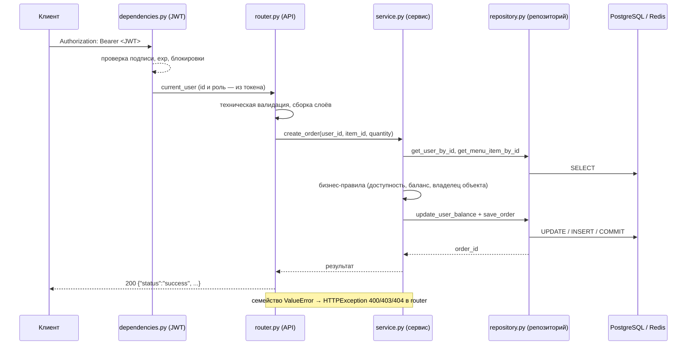
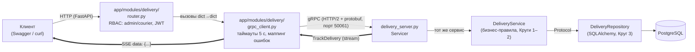

# Сириус.Еда — Clean Architecture: рефакторинг, безопасность, кеширование, асинхронность, микросервисы (ЛР № 2–№ 6)

Сквозной пет-проект по дисциплине «Разработка программных модулей и приложений для серверов». В репозитории выполнены пять практических работ:

| Работа | Тема | Что сделано |
|--------|------|-------------|
| **ЛР № 2. Рефакторинг MVP-модулей в Clean Architecture** | Разделение жёстко связанного MVP-кода на слои | Модули `orders`, `users`, `delivery` разделены на `router / service / repository`; инверсия зависимостей через конструктор и `Protocol`; unit-тесты без СУБД; архитектурный AST-тест |
| **ЛР № 3. Аутентификация и авторизация** | JWT, RBAC, IDOR, bcrypt, rate limiting | Модуль `auth`; JWT access/refresh с **ротацией**; RBAC (`student / cook / courier / admin`); защита от IDOR в Service-слое; bcrypt; миграция Alembic; rate limiting на Redis; CORS; Secure by Default; тесты безопасности |
| **ЛР № 4. Кеширование в продакшн** | Стратегия Cache-Aside, инвалидация, замеры нагрузки | Клиент Redis (`app/core/redis.py`); **Cache-Aside в Repository** (критерий Clean Architecture); событийная инвалидация + TTL; **защита от cache stampede** (distributed-лок, 9 баллов); **категории с TTL 10 мин и прогрев кеша при старте** (10 баллов); замеры Locust «до/после» с таблицей в README |
| **ЛР № 5. Асинхронность и фоновые задачи: Celery** | Вынос тяжёлых операций из HTTP-запроса в воркер | Приложение Celery (`app/core/celery_app.py`, broker/backend — Redis); **PDF/email/SMS вынесены в фоновые задачи** (`app/tasks/orders.py`), публикация через `.delay()` из Service; время ответа `POST /orders/create` **4+ сек → десятки–сотни мс**; **ретраи с exponential backoff + jitter**; **идемпотентность PDF** через флаг в Redis; **Dead Letter Queue** (`ReliableTask.on_failure`); **Celery Beat** — дневная статистика заказов; Flower для мониторинга; fail-open при недоступном брокере |
| **ЛР № 6. Вынос модуля delivery в gRPC-микросервис** | Паттерн Strangler Fig: выделение модуля в отдельный сервис | Контракт `proto/delivery.proto` (**6 RPC**), сгенерированные `delivery_pb2*.py`; gRPC-сервер `delivery_server.py` (**переиспользует `DeliveryService`** — бизнес-правила не дублируются); клиент `app/modules/delivery/grpc_client.py` с маппингом сетевых ошибок (**UNAVAILABLE → 503, DEADLINE_EXCEEDED → 504**); таймауты на каждый RPC; **Server Streaming `TrackDelivery`** (статусы in_progress → on_the_way → delivered, шаг 2 с) + SSE-эндпоинт; **Bidirectional Streaming `ChatWithCourier`** + интерактивный скрипт `scripts/grpc_chat.py`; 18 unit-тестов клиента |

> Пошаговая инструкция «как запустить и показать преподавателю» и короткий план ответа по ЛР № 4–6: [`docs/Запуск_и_защита_ЛР4-6.md`](docs/Запуск_и_защита_ЛР4-6.md).

---

## 1. Архитектура (все пять работ)

Каждый функциональный модуль разделён на три файла (`app/modules/<module>/`), направление зависимостей — только снаружи внутрь:

| Файл | Слой | Круг Мартина | Ответственность |
|------|------|--------------|-----------------|
| `router.py` | транспорт | 4. Frameworks & Drivers | приём HTTP, техническая валидация (Pydantic), сборка слоёв, перевод исключений в HTTP-статусы |
| `service.py` | бизнес-логика | 1–2. Entities & Use Cases | бизнес-правила и сценарии; **запрещены импорты `fastapi` и `sqlalchemy`** |
| `repository.py` | инфраструктура | 3. Interface Adapters | SQLAlchemy-запросы, транзакции. Единственный файл с ORM |

Плюс общий «каркас»:

```
app/
├── core/                  # сквозная инфраструктура
│   ├── config.py          # настройки из .env (SECRET_KEY обязательный) — Secure by Default
│   ├── jwt.py             # create_access_token / create_refresh_token / decode_token
│   ├── security.py        # hash_password / verify_password (bcrypt)
│   ├── dependencies.py    # get_current_user, require_role (аутентификация и RBAC)
│   ├── rate_limit.py      # rate limiting на Redis (429)
│   ├── redis.py            # общий клиент Redis: rate limiting (ЛР № 3) + кеш (ЛР № 4)
│   ├── celery_app.py       # приложение Celery: очереди, DLQ, beat_schedule (ЛР № 5)
│   └── exceptions.py      # доменные исключения: NotFoundError / ForbiddenError / BusinessRuleError
├── tasks/                  # фоновые задачи Celery (ЛР № 5)
│   └── orders.py           # generate_order_pdf / send_order_email / send_order_sms / collect_daily_order_stats
├── modules/
│   ├── auth/              # POST /auth/login, /auth/refresh (ротация refresh-токенов)
│   ├── users/             # register, topup (JWT + IDOR: пополнять можно только свой баланс)
│   ├── menu/              # чтение — Cache-Aside на Redis; изменение блюд — cook|admin
│   ├── orders/            # create, cancel (IDOR), kitchen/orders (роль cook)
│   └── delivery/          # HTTP → gRPC: router.py + grpc_client.py (assign/complete/my/track/chat)
proto/
│   └── delivery.proto     # контракт микросервиса (ЛР № 6): 6 RPC = 4 unary + 2 streaming
delivery_server.py         # gRPC-сервер доставки (порт 50061, переиспользует DeliveryService)
delivery_pb2.py            # сгенерированный код: python -m grpc_tools.protoc -Iproto --python_out=. --grpc_python_out=. proto/delivery.proto
delivery_pb2_grpc.py       # Servicer + Stub по контракту
scripts/
│   ├── grpc_chat.py       # интерактивный Bidirectional Streaming чат с курьером (ЛР № 6)
│   ├── seed_lab6.py       # сидинг демо-данных для ЛР № 6
│   └── demo_lab6.py       # живая демонстрация всех RPC через HTTP и напрямую
├── main.py                # CORS, Swagger только при DEBUG=True, seed ролей, прогрев кеша на старте
└── models.py / schemas.py
alembic/                   # миграции: ЛР № 3 (roles, refresh_tokens) и ЛР № 4 (menu_categories)
tests/                     # 91 тест (см. § 7)
```

### Путь запроса через слои (ЛР № 2)



### Инверсия зависимостей и подстановка Лисков (ЛР № 2, 9–10 баллов)

Сервисы (`OrderService`, `UserService`, `AuthService`, `DeliveryService`) получают репозиторий **через конструктор** и типизируют его `Protocol`-контрактом, объявленным прямо в `service.py`. Сервис не импортирует конкретный класс репозитория, поэтому реализация хранилища заменяется **без изменения `service.py` и `router.py`**:

* `PostgreSQL`-реализация (`app/modules/*/repository.py`) — для продакшена;
* in-memory-заглушки (`tests/test_orders_service.py`, `test_users_service.py`, `test_auth_service.py`) — для unit-тестов, которые проходят **без СУБД, FastAPI и SQLAlchemy**.

Это принцип подстановки Лисков: любая реализация контракта ведёт себя ожидаемо для сервиса. Границы слоёв проверяются автоматически `tests/test_architecture.py` (AST-разбор импортов).

Отличие от шаблона методички: доменные исключения типизированы (`NotFoundError` → 404, `ForbiddenError` → 403, `BusinessRuleError` → 400), чтобы ответы совпадали с MVP-версией, а списание баланса и создание заказа фиксируются одной транзакцией.

---

## 2. Безопасность (ЛР № 3)

### JWT и токены

* `POST /auth/login` — выдаёт пару токенов. Access-токен живёт 15 минут, refresh — 7 дней; payload содержит только `sub`, `exp`, `type`, `jti` (Base64 **не шифруется**, поэтому персональных данных там нет).
* `POST /auth/refresh` — **ротация refresh-токенов** (задание на 10):
  1. проверяется подпись и тип токена;
  2. старый refresh отзывается в БД, выдаётся **новая пара**;
  3. повторное использование уже отозванного токена расценивается как кража: **сбрасывается вся сессия** пользователя (отзыв всех его refresh-токенов) и возвращается 401.
* В БД хранится только SHA-256-хеш refresh-токена — утечка БД не даёт действующих токенов.

### RBAC (кто что может)

| Эндпоинт | Роль | Проверка |
|----------|------|----------|
| `POST /users/register`, `POST /auth/login` | аноним | — |
| `POST /users/{id}/topup` | владелец баланса (или admin) | get_current_user + право на объект в Service |
| `POST /menu/items`, `PATCH /menu/items/{id}` | cook, admin | require_role |
| `POST /orders/create` | студент (персонал не заказывает) | require_role |
| `POST /orders/{id}/cancel` | владелец заказа | get_current_user + владелец в Service |
| `GET /orders/kitchen/orders` | cook | require_role |
| `POST /delivery/assign` | admin | require_role |
| `PATCH /delivery/{id}/complete`, `GET /delivery/my` | courier | require_role + владелец в Service |
| `GET /delivery/{id}/track`, `POST /delivery/{id}/chat` (ЛР № 6) | любой аутентифицированный | get_current_user |

### Защита от IDOR

Проверка права на **конкретный объект** (`order.user_id == current_user.id`, `delivery.courier_id == ...`, пополнение только своего баланса) выполняется в **Service-слое**: это бизнес-правило, которое тестируется без HTTP и переиспользуется в CLI/воркере. `user_id` полностью убран из payload — клиент не сообщает, кто он, это берётся из подписанного токена.

### Rate limiting на Redis (9 баллов)

`app/core/rate_limit.py` — dependency `rate_limit(5, 60)` на `POST /auth/login`: не более 5 попыток входа за 60 секунд с одного IP, иначе **429**. Счётчик в Redis, а не в памяти приложения — общий для всех реплик. Если Redis недоступен — fail-open (не кладём аутентификацию), поведение покрыто unit-тестом.

### Secure by Default (9 баллов)

1. **Секреты в `.env`** (`SECRET_KEY` обязателен — без него приложение не стартует; `.env` в `.gitignore`, есть `.env.example`).
2. **CORS ограничен** списком `ALLOWED_ORIGINS` из `.env`; не `*` + credentials.
3. **Swagger отключён в продакшене**: `DEBUG=True` → `/docs` включён; `DEBUG=False` → `/docs` и `/redoc` скрыты.

### Миграция (Alembic)

`alembic/versions/a1b2c3d4e5f6_add_password_hash_roles_refresh_tokens.py` — создаёт таблицы `roles` и `refresh_tokens`, добавляет `password_hash` и `role_id` в `users`, заполняет четыре роли и назначает существующим пользователям роль `student`.

---

## 3. Кеширование: Cache-Aside на Redis (ЛР № 4)

Сценарий из методички — обеденный пик: сотни пользователей одновременно читают `GET /menu/items`. Меню меняется редко, а читается постоянно — идеальный кандидат на кеш.

### Что сделано (закрыты все критерии до 10 баллов)

* **Клиент Redis** — `app/core/redis.py`: один общий клиент (`decode_responses=True`) и `check_redis_connection()`; им пользуются и rate limiting (ЛР № 3), и кеш (ЛР № 4) — один пул соединений на приложение.
* **Cache-Aside в Repository** (`app/modules/menu/repository.py`): hit → данные из Redis; miss → запрос в PostgreSQL, результат кладётся в кеш с TTL. Кеш живёт **в Repository, а не в Service**: это деталь хранения (ускоритель СУБД), сервис не знает, откуда пришёл список блюд. Если кеш в Service — нарушены границы Clean Architecture; это отслеживает архитектурный AST-тест (`service.py` не импортирует `redis`).
* **Событийная инвалидация**: после `POST /menu/items` и `PATCH /menu/items/{id}` сервис вызывает `repository.invalidate_cache()` (ключи удаляются мгновенно, без ожидания TTL). Вызов идёт **через контракт репозитория** — сам Redis в `service.py` не импортируется.
* **TTL + события вместе**: TTL страхует от ошибки в коде инвалидации, события убирают окно устаревших данных.
* **Защита от cache stampede (критерий 9)**: при промахе запрос берёт distributed-лок `menu:all:lock` (`redis.lock`, timeout 10 с, ожидание 3 с). В PostgreSQL идёт **только один** запрос; остальные ждут лок и после double-check читают уже прогретый кеш.
* **Кеширование категорий (критерий 10)**: эндпоинт `GET /menu/categories/{id}` с ключом `menu:category:{id}` и TTL 10 минут — **отличным** от TTL меню (5 минут): категории меняются ещё реже.
* **Прогрев кеша / cache warm-up (критерий 10)**: на startup-событии (`app/main.py`) `Repository.warm_cache()` заполняет `menu:all`, `menu:categories` и все `menu:category:*` из БД — первый пользовательский запрос не попадает в miss и не конкурирует за warm-лок.
* **Fail-open при недоступном Redis**: предупреждение в лог и честное чтение из PostgreSQL — приложение замедляется, но не падает. Поведение покрыто unit-тестом с «сломанным» Redis-клиентом.
* **Переключатель `CACHE_ENABLED`** (`.env`, по умолчанию `true`): `false` — режим baseline, каждый запрос читает PostgreSQL. Им и снимался замер «до кеша».
* **Миграция** `alembic/versions/b7c8d9e0f1a2_add_menu_categories.py`: таблица `menu_categories` + колонка `menu_items.category_id`.

### Ключи и TTL

| Ключ | TTL | Назначение |
|------|-----|------------|
| `menu:all` | 300 с (5 мин) | всё меню — горячий эндпоинт |
| `menu:categories` | 600 с (10 мин) | список категорий |
| `menu:category:{id}` | 600 с (10 мин) | блюда одной категории (критерий «разные TTL») |
| `menu:*:lock` | — | краткосрочный distributed-лок от stampede |
| `rate_limit:*` | — | счётчики попыток логина (ЛР № 3, это не кеш) |

### Замеры «до / после» (Locust)

Инфраструктура: локальная машина + Docker (PostgreSQL, Redis) в контейнерах, один uvicorn-воркер. Сценарий `locustfile.py`: 3 × `GET /menu/items`, 1 × `GET /menu/categories/1` (замокан под общим именем `/menu/category`). «До» — тот же код с `CACHE_ENABLED=false`, чтобы чтение каждый раз шло в PostgreSQL.

**50 одновременных пользователей, spawn 10/с, 15 с** — чистый эффект кеша:

| Метрика | До кеша | С Cache-Aside | Эффект |
|---|---|---|---|
| Среднее время ответа | 21.6 мс | **18.7 мс** | −13% |
| Медиана | 16 мс | **15 мс** | −6% |
| 95-й перцентиль | 56 мс | **45 мс** | −20% |
| 99-й перцентиль | 100 мс | **77 мс** | −23% |
| RPS | 133.2 | **134.2** | +1% |

**500 пользователей (пик из методички), spawn 10/с, 70 с:**

| Метрика | До кеша | С Cache-Aside | Эффект |
|---|---|---|---|
| Среднее время ответа | 892 мс | **715 мс** | −20% |
| Медиана | 990 мс | **750 мс** | −24% |
| 95-й перцентиль | 1600 мс | **1300 мс** | −19% |
| 99-й перцентиль | 1600 мс | **1400 мс** | −13% |
| RPS | 267 | **313** | +17% |

Честная трактовка замеров (17.11.2026): на 500 одновременных соединениях узким местом становится уже не СУБД, а пул потоков единственного uvicorn-воркера (~40 sync-потоков): запросы выстраиваются в очередь, и выигрыш «кеш вместо БД» частично маскируется ожиданием потока. Поэтому при 500 пользователях кеш снимает 20–24% со среднего/медианы, а не в разы. При 50 пользователях база отвечает быстро (медиана 16 мс), и кеш заметно улучшает хвосты (95-й перцентиль −20%, 99-й −23%), но медиана меняется слабо. Нагрузку с PostgreSQL кеш снимает в обоих прогонах: при hit SQL-запрос вообще не выполняется. В проде с gunicorn-воркерами (по ядру) и «тяжёлыми» JOIN-запросами эффект был бы заметнее.

CSV-выгрузки замеров: `docs/locust/baseline_stats.csv`, `docs/locust/with_cache_stats.csv` (50 пользователей), `docs/locust/baseline_500_stats.csv`, `docs/locust/with_cache_500_stats.csv` (500 пользователей).

### Как повторить замеры

Windows/PowerShell (переменные окружения в PS ставятся через `$env:` и живут только в текущем окне терминала):

```powershell
docker compose up -d db redis
# терминал 1 — baseline («до кеша»), каждый запрос идёт в PostgreSQL
$env:CACHE_ENABLED="false"; $env:SQL_ECHO="false"; python -m uvicorn app.main:app --port 8010
# терминал 2 — рабочий инстанс с кешем (новое окно, ничего ставить не нужно: по умолчанию кеш включён)
python -m uvicorn app.main:app --port 8020
# терминал 3 — нагрузка
python -m locust -f locustfile.py --host=http://127.0.0.1:8010 --headless --only-summary -u 50 -r 10 -t 15s --csv docs/locust/baseline
python -m locust -f locustfile.py --host=http://127.0.0.1:8020 --headless --only-summary -u 50 -r 10 -t 15s --csv docs/locust/with_cache
python -m locust -f locustfile.py --host=http://127.0.0.1:8010 --headless --only-summary -u 500 -r 10 -t 70s --csv docs/locust/baseline_500
python -m locust -f locustfile.py --host=http://127.0.0.1:8020 --headless --only-summary -u 500 -r 10 -t 70s --csv docs/locust/with_cache_500
```

Ubuntu/bash (окружение методички — переменные прямо перед командой):

```bash
CACHE_ENABLED=false SQL_ECHO=false uvicorn app.main:app --port 8010
uvicorn app.main:app --port 8020
locust -f locustfile.py --host=http://127.0.0.1:8010 --headless --only-summary -u 50 -r 10 -t 15s --csv docs/locust/baseline
locust -f locustfile.py --host=http://127.0.0.1:8020 --headless --only-summary -u 50 -r 10 -t 15s --csv docs/locust/with_cache
locust -f locustfile.py --host=http://127.0.0.1:8010 --headless --only-summary -u 500 -r 10 -t 70s --csv docs/locust/baseline_500
locust -f locustfile.py --host=http://127.0.0.1:8020 --headless --only-summary -u 500 -r 10 -t 70s --csv docs/locust/with_cache_500
```

> **Живой веб-интерфейс для показа:** запустите Locust без `--headless`:
> `locust -f locustfile.py --host=http://127.0.0.1:8020 --web-host=127.0.0.1 --web-port=8089`, откройте
> `http://127.0.0.1:8089`, задайте `Number of users = 50`, `Spawn rate = 10` и
> нажмите **Start swarming**. Для baseline поднимите второй процесс с
> `--host=http://127.0.0.1:8010 --web-host=127.0.0.1 --web-port=8090`. Подробный сценарий — в
> [`docs/Запуск_и_защита_ЛР4-6.md`](docs/Запуск_и_защита_ЛР4-6.md).

---

## 4. Асинхронность и фоновые задачи: Celery (ЛР № 5)

Проблема: в MVP `POST /orders/create` выполнял всё синхронно — запись в PostgreSQL, генерацию PDF-чека (`sleep(2)`), отправку email (`sleep(1)`) и SMS (`sleep(1)`). Итого ~4+ секунды ответа API ради операций, которые клиенту ждать незачем.

### Архитектура: Producer → Broker → Worker → Backend

| Роль | Кто играет | Что делает |
|------|-----------|------------|
| **Producer** | FastAPI (`OrderService`) | сериализует задачу в JSON и кладёт сообщение в брокер |
| **Broker** | Redis | хранит очередь сообщений (список `default`) |
| **Worker** | `celery worker` (отдельный процесс) | забирает сообщения и исполняет задачи |
| **Backend** | Redis (тот же) | хранит результаты выполненных задач (ключи `celery-task-meta:*`) |

HTTP-ответ больше не ждёт уведомления: время ответа `POST /orders/create` **упало с 4+ секунд до десятков–сотен миллисекунд**. Замер реального прогона 17.11.2026 (Windows, один uvicorn, Redis в Docker): 448 / 128 / 72 / 82 / 84 мс — первый запрос медленнее из-за прогрева соединений с брокером, далее 72–84 мс.

### Что сделано

* **Приложение Celery** — `app/core/celery_app.py`: broker и backend на `REDIS_URL` из `.env`; сериализация **только JSON** (`pickle` запрещён через `accept_content` — подделка pickle-сообщения в брокере = исполнение произвольного кода); `task_acks_late=True` (ack после выполнения — при падении воркера сообщение вернётся в очередь) и `worker_prefetch_multiplier=1` (fair dispatch).
* **Задачи** — `app/tasks/orders.py`: `generate_order_pdf` (2 с), `send_order_email` (1 с), `send_order_sms` (1 с), периодическая `collect_daily_order_stats`.
* **Публикация из Service** (`OrderService._dispatch_notifications`): «заказ создан» — бизнес-событие, поэтому `.delay()` вызывается в Service, а не в Router (API лишь отвечает «принято»). Публикация **fail-open**: брокер недоступен → заказ не отменяется, ошибка логируется (проверено вживую: при старте API со старым redis-py заказы создавались, задачи не ставились, WARNING в логе).
* **Ретраи с exponential backoff + jitter** (`send_order_email`): `autoretry_for=(Exception,), retry_backoff=True, retry_backoff_max=600, retry_jitter=True, max_retries=3`. Симуляция сбоя: `order_id % 5 == 0` → «падает». Реальный лог воркера: `retry: Retry in 1s` → `Retry in 2s` → `Retry in 4s` (jitter слегка сдвигает интервалы).
* **Идемпотентность PDF**: флаг `pdf_generated:{order_id}` в Redis (TTL 1 час). Повторная доставка (acks_late) или ручной re-run не создадут второй чек: `повторный вызов: PDF already generated for order 6`. Если Redis недоступен — fail-open в честное выполнение (потерянный чек хуже повторного).
* **Dead Letter Queue (DLQ)**: базовый класс `ReliableTask.on_failure` публикует **валидное сообщение kombu** в очередь `dlq` (JSON: задача, id, аргументы, ошибка, время). Просмотр: `docker exec sirius_food-redis-1 redis-cli lrange dlq 0 -1`; разбор — отдельным воркером `celery -A app.core.celery_app worker -Q dlq`. Две ловушки, найденные при отладке (и закрытые в коде):
  1. нельзя писать в список `dlq` сырой JSON через `redis.rpush` — kombu хранит очередь именно в этом списке, воркер упадёт на разборе «чужого» сообщения;
  2. `dlq` нельзя объявлять в `task_queues` воркера — иначе воркеры потребляют её по умолчанию и переисполняют упавшие задачи.
* **Celery Beat** (доп. задание 10): `beat_schedule` — раз в сутки в 00:05 `collect_daily_order_stats` пишет количество заказов в ключ `stats:orders:<дата>` (TTL 7 дней). Для демо замените `schedule` на `60.0`. Запуск: `celery -A app.core.celery_app beat`.
* **Flower** (доп. задание 9): веб-мониторинг задач — `celery -A app.core.celery_app flower` → `http://localhost:5555` (активные задачи, статусы, ретраи, воркеры в реальном времени).
* **Тесты** (`tests/test_tasks.py`, 7 шт., без брокера): идемпотентность PDF (второй вызов пропускается, флаг ставится с TTL 3600), fail-open при недоступном Redis, падение email при `order_id % 5 == 0`, публикация из Service с корректными аргументами и устойчивость к падению брокера. В `tests/test_orders_service.py` публикация в брокер подменяется заглушкой — unit-тесты не требуют Redis.

### Ручная проверка (сценарий защиты)

```bash
docker compose up -d db redis
uvicorn app.main:app --port 8000                          # терминал 1 — API
celery -A app.core.celery_app worker --loglevel=info      # терминал 2 — воркер
celery -A app.core.celery_app flower                      # терминал 3 — мониторинг (9)
celery -A app.core.celery_app beat                        # терминал 4 — beat (10)
# Swagger: POST /orders/create → ответ десятки–сотни мс; в логе воркера — три задачи;
# заказ с order_id % 5 == 0 → ретраи 1-2-4 c → dead letter:
docker exec sirius_food-redis-1 redis-cli lrange dlq 0 -1
```

> **Windows:** у Celery нет prefork-пула, поэтому воркер запускается с
> `--pool=solo`:
> `celery -A app.core.celery_app worker --loglevel=info --pool=solo`.
> Beat и Flower запускаются как обычно.

---

## 5. Микросервис доставки на gRPC (ЛР № 6)

Модуль `delivery` вырезан из монолита по паттерну **Strangler Fig**: он работает **отдельным процессом** (`delivery_server.py`, порт 50061, HTTP/2 + Protocol Buffers), а FastAPI-монолит обращается к нему не через таблицу `deliveries`, а через gRPC-клиент. Постепенно «душим» монолит: транспорт модуля заменён (HTTP → gRPC), при этом всё приложение продолжает работать.

### Архитектура



Ключевое решение — **сервер не переписывает бизнес-правила**: `DeliveryGrpcService` (Servicer) — тонкий транспортный слой, который принимает protobuf-запрос, вызывает тот же `DeliveryService` с тем же `DeliveryRepository` и переводит доменные исключения в статусы gRPC. Правила «только оплаченный заказ», «один курьер — одна активная доставка» и защита от IDOR живут в **одном месте** (в отличие от шаблона методички, где логика дублировалась внутри сервера).

### Контракт: `proto/delivery.proto` (6 RPC)

| RPC | Тип | Что делает |
|-----|-----|-----------|
| `AssignCourier` | unary | назначение курьера (роль admin проверяется на HTTP-слое) |
| `CompleteDelivery` | unary | завершение доставки; `courier_id` передаётся из JWT → IDOR-проверка на сервере |
| `GetDelivery` | unary | доставка по ID заказа |
| `ListDeliveries` | unary | список доставок курьера (для `GET /delivery/my`) |
| `TrackDelivery` | **Server Streaming** | сервер сам шлёт поток статусов `in_progress → on_the_way → delivered` с паузой 2 с |
| `ChatWithCourier` | **Bidirectional Streaming** | чат «клиент ↔ курьер»: обе стороны читают и пишут в открытый канал одновременно |

Ступеньки отчёта: `.proto` → генерация (`python -m grpc_tools.protoc -Iproto --python_out=. --grpc_python_out=. proto/delivery.proto`) → сервер (`Servicer`) → клиент (`Stub`) → интеграция с FastAPI.

### Обработка сетевых ошибок (критерий 8)

Клиент `DeliveryGrpcClient` ловит `grpc.RpcError` и переводит его в понятные исключения, которые router отображает в HTTP-статусы; каждый RPC ограничен таймаутом 5 с (стриминг — 30 с), чтобы зависший вызов не висел вечно:

| Статус gRPC | Исключение клиента | HTTP | Смысл |
|-------------|--------------------|------|-------|
| `NOT_FOUND` | `NotFoundError` | **404** | доставки нет |
| `PERMISSION_DENIED` | `ForbiddenError` | **403** | чужая доставка |
| `INVALID_ARGUMENT` | `BusinessRuleError` | **400** | нарушение бизнес-правила (не оплачен, курьер занят) |
| `UNAVAILABLE` / `CANCELLED` | `ConnectionError` | **503** | микросервис упал/недоступен |
| `DEADLINE_EXCEEDED` | `TimeoutError` | **504** | таймаут |
| прочие | `RuntimeError` | **500** | неизвестный сбой |

Проверено вживую: остановка `delivery_server.py` → `POST /delivery/assign` → **503** «Delivery service is unavailable» (FastAPI продолжает отвечать); после перезапуска — снова 200. Скрипт `scripts/check_503.py` делает это автоматически: сначала выполните `python scripts/seed_lab6.py` (в нём заказ сбрасывается в `paid`), затем при остановленном `delivery_server.py` — `python scripts/check_503.py`.

### Стриминги (критерии 9 и 10)

* **Server Streaming `TrackDelivery` (9)**: сервер отправляет серию сообщений `DeliveryStatus` (три статуса с паузой 2 с), клиент только читает поток — никакого поллинга. Наружу отдан SSE-эндпоинтом `GET /delivery/{order_id}/track` (FastAPI `StreamingResponse`): `data: {"status": "on_the_way", ...}` раз в 2 секунды. `context.is_active()` в генераторе — ранний выход при отключении клиента.
* **Bidirectional Streaming `ChatWithCourier` (10)**: пока клиент пишет сообщения в открытый поток, сервер читает их и тут же отвечает (автоответы курьера: «где» → «Я в пути, буду через 10 минут», «спасибо» → вежливый ответ). Полноценный чат — интерактивный скрипт `scripts/grpc_chat.py`; в Swagger показан «одношаговый» вариант `POST /delivery/{order_id}/chat` (одно сообщение — один ответ через открытый канал).

### Запуск и демо

```bash
docker compose up -d db redis
python scripts/seed_lab6.py                                # admin / courier / student + оплаченный заказ
python delivery_server.py                                  # терминал 1 — gRPC-микросервис (50061)
python -m uvicorn app.main:app --port 8000                 # терминал 2 — API (8000)
python scripts/demo_lab6.py                                # терминал 3 — все RPC: 200/400/403 + SSE-трек
python scripts/grpc_chat.py <order_id>                     # терминал 3 — чат с курьером (bidi)
```

`seed_lab6.py` печатает реальные `id` пользователей и заказа. `demo_lab6.py`
теперь сам берёт `order_id` и `courier_id` из БД, поэтому хардкод ID не нужен.
Для `grpc_chat.py` подставьте `order_id` из вывода `seed_lab6.py`.

> Порт 50061, а не канонический 50051: на Windows с Hyper-V диапазон 50000–50059 попадает в зарезервированные (`netsh int ipv4 show excludedportrange protocol=tcp`), bind там невозможен. Порт настраивается в `.env` (`DELIVERY_SERVICE_PORT`) и читается **и сервером, и клиентом** из одного источника.

Тесты клиента: `tests/test_grpc_client.py` (18 unit, без сети): fake-stub с инжекцией через конструктор (DI), маппинг всех статусов ошибок, успешные пути, чтение обоих стримингов.

---

## 6. Запуск

```bash
python3 -m venv .venv                          # Windows: .venv\Scripts\activate
source .venv/bin/activate
pip install -r requirements.txt
cp .env.example .env                           # и подставить свои значения
docker compose up -d db redis
alembic upgrade head                           # миграция (при уже существующей схеме достаточно)
uvicorn app.main:app --reload
```

Swagger: `http://127.0.0.1:8000/docs` (виден при `DEBUG=True`).

> **Если таблицы уже созданы старым запуском, а `alembic_version` нет:**
> `alembic upgrade head` упадёт на `DuplicateTable`. Один раз выполните
> `alembic stamp a1b2c3d4e5f6`, затем `alembic upgrade head` — применятся
> только новые миграции (категории меню, ЛР № 4).

> **Если порт 6379 занят локальной службой Redis 5.x:** она не поддерживает
> RESP3, который нужен `redis-py 8`. Поднимите контейнер Redis 7 на другом
> порту: в `.env` задайте `REDIS_PORT=6380` и
> `REDIS_URL=redis://localhost:6380`, затем `docker compose up -d redis`.

### Ручная проверка в Swagger (сценарии из методички)

1. `POST /orders/create` без заголовка → **401**.
2. `POST /users/register` → логин `POST /auth/login` → `Authorization: Bearer <access_token>` → `POST /orders/create` → `{"status":"success","order_id":1}`.
3. Второй студент отменяет заказ первого (`POST /orders/{id}/cancel`) → **403** (IDOR).
4. Студент вызывает `GET /orders/kitchen/orders` → **403** (RBAC); cook → 200.
5. 6 попыток `POST /auth/login` с неверным паролем → на 6-й **429** (rate limiting).
6. `POST /auth/refresh` со старым refresh-токеном дважды: первый раз 200 (новая пара), второй раз **401** + сессия сброшена — даже недавно выданный refresh больше не работает.
7. `GET /menu/items` → в Redis появился ключ `menu:all`: `docker exec sirius_food-redis-1 redis-cli TTL menu:all` возвращает ≤ 300 (hit по кешу).
8. `POST /menu/items` (cook) → повторный `GET /menu/items` — новое блюдо видно **сразу** (событийная инвалидация: ключи сброшены и прогреты заново), не дожидаясь TTL.

## 7. Тесты (91 шт.)

```bash
# unit (без СУБД, Redis, брокера и сети): сервисы на in-memory заглушках +
# архитектурный тест + задачи + gRPC-клиент на fake-stub
python -m pytest tests/test_architecture.py tests/test_orders_service.py tests/test_users_service.py tests/test_auth_service.py tests/test_rate_limit.py tests/test_tasks.py tests/test_grpc_client.py -v

# интеграционные (нужны PostgreSQL и Redis из docker compose)
python -m pytest tests/test_menu_cache.py tests/test_security_api.py -v
```

| Файл | Что проверяет |
|------|---------------|
| `test_architecture.py` | в `service.py` нет `fastapi`/`sqlalchemy`, сервис не зависит от конкретного репозитория, у модулей 3 файла, в роутере нет ORM |
| `test_orders_service.py` | бизнес-правила заказов на in-memory репозитории (баланс, доступность, отмена чужого заказа и т.д.) — СУБД не нужна |
| `test_users_service.py` | регистрация (bcrypt-хеш, дубликат email), пополнение (IDOR, заблокированный, лимит) |
| `test_auth_service.py` | **ротация refresh-токенов**: пара новая, старый отозван, повторное использование гасит всю сессию; access ≠ refresh; bcrypt |
| `test_rate_limit.py` | счётчики по IP+путь, лимит → 429, fail-open при недоступном Redis |
| `test_menu_cache.py` | кеш (ЛР № 4): ключ `menu:all` с TTL ≈ 300, новое блюдо видно сразу после POST (событийная инвалидация), после PATCH ключи `menu:all` и `menu:category:{id}` удалены, TTL категории ≈ 600 (дольше, чем у меню), 404 несуществующей категории, fail-open на «сломанном» Redis (unit, in-memory SQLite) |
| `test_security_api.py` | сквозные HTTP-сценарии против тестовой БД: 401 без токена, 403 RBAC/IDOR, поток «регистрация → логин → refresh», чужой `user_id` игнорируется, брутфорс → 429 |
| `test_tasks.py` | фоновые задачи (ЛР № 5): идемпотентность PDF (повтор пропущен, флаг с TTL 3600), fail-open при недоступном Redis, падение email при `order_id % 5 == 0`, публикация из Service с верными аргументами и не теряющая заказ при падении брокера |
| `test_grpc_client.py` | gRPC-клиент (ЛР № 6): маппинг статусов gRPC на исключения (NOT_FOUND/UNAVAILABLE/DEADLINE_EXCEEDED/INVALID_ARGUMENT/…), успешные пути всех unary-методов, чтение Server Streaming (три статуса) и Bidirectional Streaming (чат); сеть не нужна — fake-stub инжектируется в конструктор |

Тестовая БД (`sirius_food_test`) создаётся и удаляется автоматически — рабочая база не затрагивается; движок тестов пересоздаётся на URL тестовой БД независимо от порядка импорта модулей pytest.

## 8. Соответствие критериям

| Критерий | Как выполнено |
|----------|---------------|
| **ЛР № 2, 6–7**: три слоя, без `fastapi`/`sqlalchemy` в `service.py`, DI через конструктор, работоспособность в Swagger | ✅ `orders`, `users` (+ `delivery`, `auth`); ответы идентичны MVP |
| **ЛР № 2, 8**: unit-тест `service.py` без СУБД, README | ✅ + архитектурный тест; этот README |
| **ЛР № 2, 9**: два модуля вместо одного либо ABC-интерфейс | ✅ рефакторинг `orders`, `users`, `delivery`; контракт `Protocol` в каждом `service.py` |
| **ЛР № 2, 10**: замена реализации репозитория без изменения `service.py`/`router.py` (LSP) | ✅ in-memory-реализации контракта подставляются в тестах; `service.py` и `router.py` не меняются при подстановке |
| **ЛР № 3, 6–7**: JWT, RBAC, IDOR, `user_id` убран из payload, bcrypt | ✅ |
| **ЛР № 3, 8**: ≥ 4 теста на безопасность, README | ✅ тестов намного больше четырёх |
| **ЛР № 3, 9**: rate limiting на Redis, CORS, `.env`, Swagger off в продакшене | ✅ все четыре пункта |
| **ЛР № 3, 10**: одно задание на выбор | ✅ вариант А — Refresh Token rotation (новая пара, отзыв старого, сброс сессии при replay); дополнительно защищены модули `users`, `delivery`, `menu` (вариант Б) |
| **ЛР № 4, 6–7**: Cache-Aside в Repository, TTL, событийная инвалидация, работоспособность в Swagger, замеры Locust | ✅ кеш в `menu/repository.py` (ключи `menu:all`, `menu:category:{id}`), инвалидация после POST/PATCH; Swagger-сценарий демо — § 4, замеры — § 3 |
| **ЛР № 4, 8**: README со сравнительной таблицей «до/после» (RPS, latency), понимание на защите | ✅ две таблицы замеров + честная трактовка пикового прогона — § 3 |
| **ЛР № 4, 9**: защита от cache stampede | ✅ distributed-лок `redis.lock` (timeout 10 с, ожидание 3 с) + double-check после захвата: в БД при miss идёт только один запрос |
| **ЛР № 4, 10**: категории с разными TTL **и/или** прогрев кеша на старте | ✅ выполнены оба пункта: `menu:category:{id}` с TTL 600 с (против 300 с у меню) + `warm_cache()` на startup-событии |
| **ЛР № 5, 6–7**: Celery + Redis, все три операции в фоне, `POST /orders/create` отвечает быстро, проверено в Swagger | ✅ `app/core/celery_app.py` + `app/tasks/orders.py`; время ответа 4+ с → 72–84 мс (первый запрос ~0.4 с на прогрев); воркер показывает `generate_order_pdf`, `send_order_email`, `send_order_sms` |
| **ЛР № 5, 8**: ретраи + идемпотентность, README, тесты | ✅ backoff 1→2→4 с с jitter (лог воркера), флаг `pdf_generated:{id}` в Redis, fail-open, тесты `test_tasks.py` |
| **ЛР № 5, 9**: Dead Letter Queue | ✅ `ReliableTask.on_failure` публикует валидное сообщение kombu в очередь `dlq`; проверка `redis-cli lrange dlq 0 -1`; найденные при отладке ловушки документированы (сырой rpush и потребление dlq воркером) |
| **ЛР № 5, 10**: Flower **и/или** Celery Beat | ✅ выполнены оба пункта: Flower (инструкция + скриншот-сценарий) и Beat (дневная статистика заказов в `stats:orders:<дата>`, TTL 7 дней) |
| **ЛР № 6, 6–7**: `.proto` + генерация, gRPC-сервер отвечает, клиент интегрирован (monolith → service), README | ✅ `proto/delivery.proto` (6 RPC), `delivery_pb2*.py`, сервер `delivery_server.py`, клиент `app/modules/delivery/grpc_client.py`, роутер переключён на gRPC; этот раздел README |
| **ЛР № 6, 8**: обработка сетевых ошибок и таймаутов, README | ✅ маппинг `UNAVAILABLE → 503`, `DEADLINE_EXCEEDED → 504`, `NOT_FOUND/PERMISSION_DENIED/INVALID_ARGUMENT → 404/403/400`; таймаут 5 с на RPC; проверено вживую (остановка микросервиса → 503); 18 unit-тестов на fake-stub |
| **ЛР № 6, 9**: Server Streaming `TrackDelivery` | ✅ сервер шлёт `in_progress → on_the_way → delivered` с паузой 2 с; наружу — SSE `GET /delivery/{order_id}/track`; лог сервера фиксирует каждый этап |
| **ЛР № 6, 10**: Bidirectional Streaming `ChatWithCourier` + тестирующий скрипт | ✅ чат в открытом двустороннем канале; скрипт `scripts/grpc_chat.py` (автоответы курьера); «одношаговый» вариант в Swagger (`POST /delivery/{order_id}/chat`) |

## 9. История коммитов

Процесс выполнения отражён в `git log`: исходный MVP → рефакторинг `orders` → `users` → тесты и README (ЛР № 2) → `core` (jwt/security/config/dependencies), модуль `auth`, миграция, защита модулей, тесты безопасности (ЛР № 3) → кеш: `core/redis`, рефакторинг `menu` (repository/service/router/exceptions), миграция категорий, locustfile, README (ЛР № 4) → Celery: `core/celery_app`, пакет `tasks`, `.delay()` в `OrderService`, ретраи/идемпотентность/DLQ/Beat, тесты `test_tasks.py`, README (ЛР № 5) → микросервис: `proto/delivery.proto`, генерация `delivery_pb2*.py`, сервер `delivery_server.py`, клиент `grpc_client.py`, переписанный роутер `delivery` (HTTP → gRPC, SSE-трек, one-shot чат), тесты `test_grpc_client.py`, скрипты демо/чата/сидинга, README (ЛР № 6).
