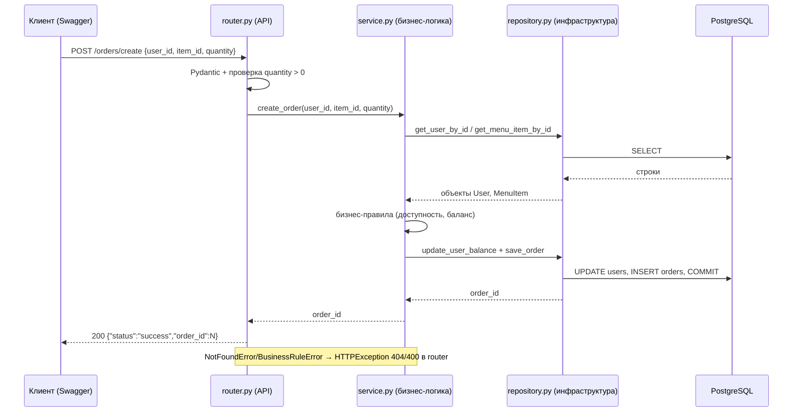

# Сириус.Еда — рефакторинг MVP-модулей в Clean Architecture

Лабораторная работа № 2 по дисциплине «Разработка программных модулей и приложений для серверов».

В модульном монолите (`users`, `menu`, `orders`, `delivery`) отрефакторены **два модуля**:

| Модуль | Кто выполнял | Статус |
|--------|--------------|--------|
| `orders` | разбор по шаблону методички | ✅ router / service / repository |
| `users`  | самостоятельное задание | ✅ router / service / repository |
| `menu`, `delivery` | — | остались в MVP-виде (не требуется) |

## Что изменилось

Каждый модуль разделён на три файла (`app/modules/<module>/`):

| Файл | Слой | Круг модели Мартина | Ответственность |
|------|------|---------------------|-----------------|
| `router.py` | API / транспорт | 4. Frameworks & Drivers | приём HTTP, техническая валидация, сборка слоёв, перевод исключений в HTTP-статусы |
| `service.py` | бизнес-логика | 1–2. Entities & Use Cases | бизнес-правила и сценарий; **без импортов `fastapi` и `sqlalchemy`** |
| `repository.py` | инфраструктура | 3. Interface Adapters | SQLAlchemy-запросы, транзакции |

Дополнительно:

* `app/core/exceptions.py` — доменные исключения (`NotFoundError`, `ForbiddenError`, `BusinessRuleError`, все наследуют `ValueError`). Нужны, чтобы сервис не знал про HTTP, но роутер мог вернуть **те же коды 400/403/404, что и в MVP**.
* Инверсия зависимостей: `OrderService(repository)` / `UserService(repository)` получают репозиторий через конструктор. Контракт описан `Protocol` прямо в `service.py` — сервис не импортирует конкретный репозиторий.
* `tests/` — unit-тесты сервисов на in-memory заглушках (СУБД не нужна) и архитектурный тест, проверяющий импорты через AST.
* `app/database.py` — включён `echo` (переменная `SQL_ECHO`) для просмотра SQL-логов.

### Отличия от шаблона методички (и почему)

1. **Статусы и тексты ошибок как в MVP.** В шаблоне все `ValueError` превращаются в 400, но MVP отдавал 404 для «не найдено» — требование «ответы идентичны» важнее, поэтому исключения типизированы.
2. **Атомарность заказа.** В MVP списание баланса и создание заказа фиксировались одним `commit`. В шаблоне два `commit` подряд — при сбое между ними баланс списался бы без заказа. Поэтому `update_user_balance` в `orders` не коммитит, а `save_order` фиксирует обе операции вместе.
3. Путь роутера остаётся `/create` (префикс `/orders` добавляет `main.py`), итоговый URL — `POST /orders/create`.

## Путь запроса через слои



Направление зависимостей (импортов) — только снаружи внутрь:

```
router.py ──► service.py ◄── (Protocol) ── repository.py
   │              │                              │
 fastapi     только Python                  sqlalchemy
```

## Запуск

```bash
python3 -m venv .venv && source .venv/bin/activate
pip install -r requirements.txt
sudo docker-compose up -d db redis
uvicorn app.main:app --reload
```

Swagger: <http://127.0.0.1:8000/docs>. В терминале видны SQL-логи (`INSERT`/`UPDATE`).

## Тесты

```bash
python -m unittest discover -s tests -t . -v      # без доп. зависимостей
# или: pip install -r requirements-dev.txt && pytest
```

Тесты не требуют PostgreSQL, FastAPI и SQLAlchemy.

## Ручная проверка в Swagger

1. `POST /users/register` `{"email":"s@mail.ru","phone":"+79990001122"}` → `{"status":"success","user_id":1,"email":"s@mail.ru"}`
2. `POST /users/1/topup?amount=1000` → `{"status":"success","new_balance":1000.0}`
3. `POST /menu/items` `{"name":"Борщ","price":150}` → `{"status":"success","item_id":1}`
4. `POST /orders/create` `{"user_id":1,"item_id":1,"quantity":2}` → `{"status":"success","order_id":1}`; баланс пользователя 700.
5. Ошибки: `quantity=0` → 400; несуществующий пользователь → 404; недостаточно средств → 400; пополнение заблокированному → 403.

## История коммитов

Выполнение отражено в `git log`: исходный MVP → `orders` (repository → service → router) → `users` (repository → service → router) → тесты → README.
