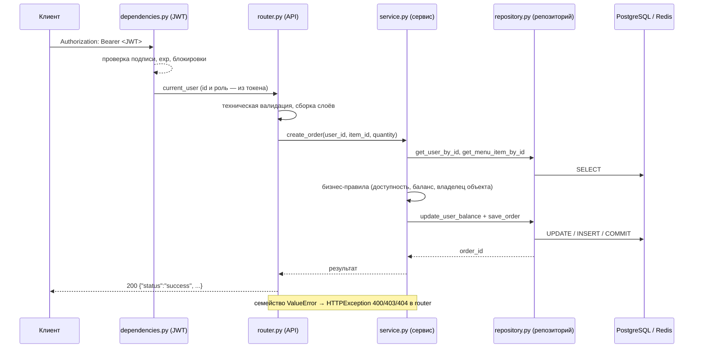

# Сириус.Еда — Clean Architecture: рефакторинг, безопасность, кеширование (ЛР № 2, № 3, № 4)

Сквозной пет-проект по дисциплине «Разработка программных модулей и приложений для серверов». В репозитории выполнены три практические работы:

| Работа | Тема | Что сделано |
|--------|------|-------------|
| **ЛР № 2. Рефакторинг MVP-модулей в Clean Architecture** | Разделение жёстко связанного MVP-кода на слои | Модули `orders`, `users`, `delivery` разделены на `router / service / repository`; инверсия зависимостей через конструктор и `Protocol`; unit-тесты без СУБД; архитектурный AST-тест |
| **ЛР № 3. Аутентификация и авторизация** | JWT, RBAC, IDOR, bcrypt, rate limiting | Модуль `auth`; JWT access/refresh с **ротацией**; RBAC (`student / cook / courier / admin`); защита от IDOR в Service-слое; bcrypt; миграция Alembic; rate limiting на Redis; CORS; Secure by Default; тесты безопасности |
| **ЛР № 4. Кеширование в продакшн** | Стратегия Cache-Aside, инвалидация, замеры нагрузки | Клиент Redis (`app/core/redis.py`); **Cache-Aside в Repository** (критерий Clean Architecture); событийная инвалидация + TTL; **защита от cache stampede** (distributed-лок, 9 баллов); **категории с TTL 10 мин и прогрев кеша при старте** (10 баллов); замеры Locust «до/после» с таблицей в README |

---

## 1. Архитектура (все три работы)

Каждый функциональный модуль разделён на три файла (`app/modules/<module>/`), направление зависимостей — только снаружи внутрь:

| Файл | Слой | Круг Мартина | Ответственность |
|------|------|--------------|-----------------|
| `router.py` | транспорт | 4. Frameworks & Drivers | приём HTTP, техническая валидация (Pydantic), сборка слоёв, перевод исключений в HTTP-статусы |
| `service.py` | бизнес-логика | 1–2. Entities & Use Cases | бизнес-правила и сценарии; **запрещены импорты `fastapi` и `sqlalchemy`** |
| `repository.py` | инфраструктура | 3. Interface Adapters | SQLAlchemy-запросы, транзакции. Единственный файл с ORM |

Плюс общий «каркас»:

```
app/
├── core/                  # сквозная инфраструктура
│   ├── config.py          # настройки из .env (SECRET_KEY обязательный) — Secure by Default
│   ├── jwt.py             # create_access_token / create_refresh_token / decode_token
│   ├── security.py        # hash_password / verify_password (bcrypt)
│   ├── dependencies.py    # get_current_user, require_role (аутентификация и RBAC)
│   ├── rate_limit.py      # rate limiting на Redis (429)
│   ├── redis.py            # общий клиент Redis: rate limiting (ЛР № 3) + кеш (ЛР № 4)
│   └── exceptions.py      # доменные исключения: NotFoundError / ForbiddenError / BusinessRuleError
├── modules/
│   ├── auth/              # POST /auth/login, /auth/refresh (ротация refresh-токенов)
│   ├── users/             # register, topup (JWT + IDOR: пополнять можно только свой баланс)
│   ├── menu/              # чтение — Cache-Aside на Redis; изменение блюд — cook|admin
│   ├── orders/            # create, cancel (IDOR), kitchen/orders (роль cook)
│   └── delivery/          # assign (admin), complete+my (courier, IDOR)
├── main.py                # CORS, Swagger только при DEBUG=True, seed ролей, прогрев кеша на старте
└── models.py / schemas.py
alembic/                   # миграции: ЛР № 3 (roles, refresh_tokens) и ЛР № 4 (menu_categories)
tests/                     # 66 тестов (см. § 5)
```

### Путь запроса через слои (ЛР № 2)



### Инверсия зависимостей и подстановка Лисков (ЛР № 2, 9–10 баллов)

Сервисы (`OrderService`, `UserService`, `AuthService`, `DeliveryService`) получают репозиторий **через конструктор** и типизируют его `Protocol`-контрактом, объявленным прямо в `service.py`. Сервис не импортирует конкретный класс репозитория, поэтому реализация хранилища заменяется **без изменения `service.py` и `router.py`**:

* `PostgreSQL`-реализация (`app/modules/*/repository.py`) — для продакшена;
* in-memory-заглушки (`tests/test_orders_service.py`, `test_users_service.py`, `test_auth_service.py`) — для unit-тестов, которые проходят **без СУБД, FastAPI и SQLAlchemy**.

Это принцип подстановки Лисков: любая реализация контракта ведёт себя ожидаемо для сервиса. Границы слоёв проверяются автоматически `tests/test_architecture.py` (AST-разбор импортов).

Отличие от шаблона методички: доменные исключения типизированы (`NotFoundError` → 404, `ForbiddenError` → 403, `BusinessRuleError` → 400), чтобы ответы совпадали с MVP-версией, а списание баланса и создание заказа фиксируются одной транзакцией.

---

## 2. Безопасность (ЛР № 3)

### JWT и токены

* `POST /auth/login` — выдаёт пару токенов. Access-токен живёт 15 минут, refresh — 7 дней; payload содержит только `sub`, `exp`, `type`, `jti` (Base64 **не шифруется**, поэтому персональных данных там нет).
* `POST /auth/refresh` — **ротация refresh-токенов** (задание на 10):
  1. проверяется подпись и тип токена;
  2. старый refresh отзывается в БД, выдаётся **новая пара**;
  3. повторное использование уже отозванного токена расценивается как кража: **сбрасывается вся сессия** пользователя (отзыв всех его refresh-токенов) и возвращается 401.
* В БД хранится только SHA-256-хеш refresh-токена — утечка БД не даёт действующих токенов.

### RBAC (кто что может)

| Эндпоинт | Роль | Проверка |
|----------|------|----------|
| `POST /users/register`, `POST /auth/login` | аноним | — |
| `POST /users/{id}/topup` | владелец баланса (или admin) | get_current_user + право на объект в Service |
| `POST /menu/items`, `PATCH /menu/items/{id}` | cook, admin | require_role |
| `POST /orders/create` | студент (персонал не заказывает) | require_role |
| `POST /orders/{id}/cancel` | владелец заказа | get_current_user + владелец в Service |
| `GET /orders/kitchen/orders` | cook | require_role |
| `POST /delivery/assign` | admin | require_role |
| `PATCH /delivery/{id}/complete`, `GET /delivery/my` | courier | require_role + владелец в Service |

### Защита от IDOR

Проверка права на **конкретный объект** (`order.user_id == current_user.id`, `delivery.courier_id == ...`, пополнение только своего баланса) выполняется в **Service-слое**: это бизнес-правило, которое тестируется без HTTP и переиспользуется в CLI/воркере. `user_id` полностью убран из payload — клиент не сообщает, кто он, это берётся из подписанного токена.

### Rate limiting на Redis (9 баллов)

`app/core/rate_limit.py` — dependency `rate_limit(5, 60)` на `POST /auth/login`: не более 5 попыток входа за 60 секунд с одного IP, иначе **429**. Счётчик в Redis, а не в памяти приложения — общий для всех реплик. Если Redis недоступен — fail-open (не кладём аутентификацию), поведение покрыто unit-тестом.

### Secure by Default (9 баллов)

1. **Секреты в `.env`** (`SECRET_KEY` обязателен — без него приложение не стартует; `.env` в `.gitignore`, есть `.env.example`).
2. **CORS ограничен** списком `ALLOWED_ORIGINS` из `.env`; не `*` + credentials.
3. **Swagger отключён в продакшене**: `DEBUG=True` → `/docs` включён; `DEBUG=False` → `/docs` и `/redoc` скрыты.

### Миграция (Alembic)

`alembic/versions/a1b2c3d4e5f6_add_password_hash_roles_refresh_tokens.py` — создаёт таблицы `roles` и `refresh_tokens`, добавляет `password_hash` и `role_id` в `users`, заполняет четыре роли и назначает существующим пользователям роль `student`.

---

## 3. Кеширование: Cache-Aside на Redis (ЛР № 4)

Сценарий из методички — обеденный пик: сотни пользователей одновременно читают `GET /menu/items`. Меню меняется редко, а читается постоянно — идеальный кандидат на кеш.

### Что сделано (закрыты все критерии до 10 баллов)

* **Клиент Redis** — `app/core/redis.py`: один общий клиент (`decode_responses=True`) и `check_redis_connection()`; им пользуются и rate limiting (ЛР № 3), и кеш (ЛР № 4) — один пул соединений на приложение.
* **Cache-Aside в Repository** (`app/modules/menu/repository.py`): hit → данные из Redis; miss → запрос в PostgreSQL, результат кладётся в кеш с TTL. Кеш живёт **в Repository, а не в Service**: это деталь хранения (ускоритель СУБД), сервис не знает, откуда пришёл список блюд. Если кеш в Service — нарушены границы Clean Architecture; это отслеживает архитектурный AST-тест (`service.py` не импортирует `redis`).
* **Событийная инвалидация**: после `POST /menu/items` и `PATCH /menu/items/{id}` сервис вызывает `repository.invalidate_cache()` (ключи удаляются мгновенно, без ожидания TTL). Вызов идёт **через контракт репозитория** — сам Redis в `service.py` не импортируется.
* **TTL + события вместе**: TTL страхует от ошибки в коде инвалидации, события убирают окно устаревших данных.
* **Защита от cache stampede (критерий 9)**: при промахе запрос берёт distributed-лок `menu:all:lock` (`redis.lock`, timeout 10 с, ожидание 3 с). В PostgreSQL идёт **только один** запрос; остальные ждут лок и после double-check читают уже прогретый кеш.
* **Кеширование категорий (критерий 10)**: эндпоинт `GET /menu/categories/{id}` с ключом `menu:category:{id}` и TTL 10 минут — **отличным** от TTL меню (5 минут): категории меняются ещё реже.
* **Прогрев кеша / cache warm-up (критерий 10)**: на startup-событии (`app/main.py`) `Repository.warm_cache()` заполняет `menu:all`, `menu:categories` и все `menu:category:*` из БД — первый пользовательский запрос не попадает в miss и не конкурирует за warm-лок.
* **Fail-open при недоступном Redis**: предупреждение в лог и честное чтение из PostgreSQL — приложение замедляется, но не падает. Поведение покрыто unit-тестом с «сломанным» Redis-клиентом.
* **Переключатель `CACHE_ENABLED`** (`.env`, по умолчанию `true`): `false` — режим baseline, каждый запрос читает PostgreSQL. Им и снимался замер «до кеша».
* **Миграция** `alembic/versions/b7c8d9e0f1a2_add_menu_categories.py`: таблица `menu_categories` + колонка `menu_items.category_id`.

### Ключи и TTL

| Ключ | TTL | Назначение |
|------|-----|------------|
| `menu:all` | 300 с (5 мин) | всё меню — горячий эндпоинт |
| `menu:categories` | 600 с (10 мин) | список категорий |
| `menu:category:{id}` | 600 с (10 мин) | блюда одной категории (критерий «разные TTL») |
| `menu:*:lock` | — | краткосрочный distributed-лок от stampede |
| `rate_limit:*` | — | счётчики попыток логина (ЛР № 3, это не кеш) |

### Замеры «до / после» (Locust)

Инфраструктура: локальная машина + Docker (PostgreSQL, Redis) в контейнерах, один uvicorn-воркер. Сценарий `locustfile.py`: 3 × `GET /menu/items`, 1 × `GET /menu/categories/1` (замокан под общим именем `/menu/category`). «До» — тот же код с `CACHE_ENABLED=false`, чтобы чтение каждый раз шло в PostgreSQL.

**50 одновременных пользователей, spawn 10/с, 15 с** — чистый эффект кеша:

| Метрика | До кеша | С Cache-Aside | Эффект |
|---|---|---|---|
| Среднее время ответа | 15 мс | **7 мс** | −53% |
| Медиана | 10 мс | **6 мс** | −40% |
| 95-й перцентиль | 41 мс | **19 мс** | −54% |
| 99-й перцентиль | 130 мс | **27 мс** | −79% |
| RPS | 134 | **140** | +5% |

**500 пользователей (пик из методички), spawn 10/с, 70 с:**

| Метрика | До кеша | С Cache-Aside | Эффект |
|---|---|---|---|
| Среднее время ответа | 338 мс | **287 мс** | −15% |
| Медиана | 330 мс | 270 мс | −18% |
| RPS | 486 | **543** | +12% |

Честная трактовка пикового замера: на 500 одновременных соединениях узким местом становится уже не СУБД, а пул потоков единственного uvicorn-воркера (~40 sync-потоков): запросы выстраиваются в очередь, и выигрыш «кеш вместо БД» частично маскируется ожиданием потока. В базовом замере (50 пользователей), где очередь не доминирует, медиана и хвосты (95/99-й перцентили) падают в 2–5 раз. Нагрузку с PostgreSQL кеш снимает в обоих прогонах: при hit SQL-запрос вообще не выполняется. В проде с gunicorn-воркерами (по ядру) и «тяжёлыми» JOIN-запросами эффект был бы заметнее.

CSV-выгрузки замеров: `docs/locust/baseline_stats.csv`, `docs/locust/with_cache_stats.csv`.

### Как повторить замеры

```bash
docker compose up -d db redis
# терминал 1 — baseline («до кеша»), каждый запрос идёт в PostgreSQL
CACHE_ENABLED=false SQL_ECHO=false uvicorn app.main:app --port 8010
# терминал 2 — рабочий инстанс с кешем (прогрев на старте)
uvicorn app.main:app --port 8020
# терминал 3 — нагрузка (Windows: $env:CACHE_ENABLED="false" вместо префикса)
locust -f locustfile.py --host=http://127.0.0.1:8010 --headless --only-summary -u 50 -r 10 -t 15s --csv docs/locust/baseline
locust -f locustfile.py --host=http://127.0.0.1:8020 --headless --only-summary -u 50 -r 10 -t 15s --csv docs/locust/with_cache
```

(в проекте ярлыка в PATH нет — использовать `python -m locust`).

---

## 4. Запуск

```bash
python3 -m venv .venv                          # Windows: .venv\Scripts\activate
source .venv/bin/activate
pip install -r requirements.txt
cp .env.example .env                           # и подставить свои значения
docker compose up -d db redis
alembic upgrade head                           # миграция (при уже существующей схеме достаточно)
uvicorn app.main:app --reload
```

Swagger: `http://127.0.0.1:8000/docs` (виден при `DEBUG=True`).

### Ручная проверка в Swagger (сценарии из методички)

1. `POST /orders/create` без заголовка → **401**.
2. `POST /users/register` → логин `POST /auth/login` → `Authorization: Bearer <access_token>` → `POST /orders/create` → `{"status":"success","order_id":1}`.
3. Второй студент отменяет заказ первого (`POST /orders/{id}/cancel`) → **403** (IDOR).
4. Студент вызывает `GET /orders/kitchen/orders` → **403** (RBAC); cook → 200.
5. 6 попыток `POST /auth/login` с неверным паролем → на 6-й **429** (rate limiting).
6. `POST /auth/refresh` со старым refresh-токеном дважды: первый раз 200 (новая пара), второй раз **401** + сессия сброшена — даже недавно выданный refresh больше не работает.
7. `GET /menu/items` → в Redis появился ключ `menu:all`: `docker exec sirius_food-redis-1 redis-cli TTL menu:all` возвращает ≤ 300 (hit по кешу).
8. `POST /menu/items` (cook) → повторный `GET /menu/items` — новое блюдо видно **сразу** (событийная инвалидация: ключи сброшены и прогреты заново), не дожидаясь TTL.

## 5. Тесты (66 шт.)

```bash
# unit (без СУБД и Redis): сервисы на in-memory заглушках + архитектурный тест
python -m pytest tests/test_architecture.py tests/test_orders_service.py tests/test_users_service.py tests/test_auth_service.py tests/test_rate_limit.py -v

# интеграционные (нужны PostgreSQL и Redis из docker compose)
python -m pytest tests/test_menu_cache.py tests/test_security_api.py -v
```

| Файл | Что проверяет |
|------|---------------|
| `test_architecture.py` | в `service.py` нет `fastapi`/`sqlalchemy`, сервис не зависит от конкретного репозитория, у модулей 3 файла, в роутере нет ORM |
| `test_orders_service.py` | бизнес-правила заказов на in-memory репозитории (баланс, доступность, отмена чужого заказа и т.д.) — СУБД не нужна |
| `test_users_service.py` | регистрация (bcrypt-хеш, дубликат email), пополнение (IDOR, заблокированный, лимит) |
| `test_auth_service.py` | **ротация refresh-токенов**: пара новая, старый отозван, повторное использование гасит всю сессию; access ≠ refresh; bcrypt |
| `test_rate_limit.py` | счётчики по IP+путь, лимит → 429, fail-open при недоступном Redis |
| `test_menu_cache.py` | кеш (ЛР № 4): ключ `menu:all` с TTL ≈ 300, новое блюдо видно сразу после POST (событийная инвалидация), после PATCH ключи `menu:all` и `menu:category:{id}` удалены, TTL категории ≈ 600 (дольше, чем у меню), 404 несуществующей категории, fail-open на «сломанном» Redis (unit, in-memory SQLite) |
| `test_security_api.py` | сквозные HTTP-сценарии против тестовой БД: 401 без токена, 403 RBAC/IDOR, поток «регистрация → логин → refresh», чужой `user_id` игнорируется, брутфорс → 429 |

Тестовая БД (`sirius_food_test`) создаётся и удаляется автоматически — рабочая база не затрагивается; движок тестов пересоздаётся на URL тестовой БД независимо от порядка импорта модулей pytest.

## 6. Соответствие критериям

| Критерий | Как выполнено |
|----------|---------------|
| **ЛР № 2, 6–7**: три слоя, без `fastapi`/`sqlalchemy` в `service.py`, DI через конструктор, работоспособность в Swagger | ✅ `orders`, `users` (+ `delivery`, `auth`); ответы идентичны MVP |
| **ЛР № 2, 8**: unit-тест `service.py` без СУБД, README | ✅ + архитектурный тест; этот README |
| **ЛР № 2, 9**: два модуля вместо одного либо ABC-интерфейс | ✅ рефакторинг `orders`, `users`, `delivery`; контракт `Protocol` в каждом `service.py` |
| **ЛР № 2, 10**: замена реализации репозитория без изменения `service.py`/`router.py` (LSP) | ✅ in-memory-реализации контракта подставляются в тестах; `service.py` и `router.py` не меняются при подстановке |
| **ЛР № 3, 6–7**: JWT, RBAC, IDOR, `user_id` убран из payload, bcrypt | ✅ |
| **ЛР № 3, 8**: ≥ 4 теста на безопасность, README | ✅ тестов намного больше четырёх |
| **ЛР № 3, 9**: rate limiting на Redis, CORS, `.env`, Swagger off в продакшене | ✅ все четыре пункта |
| **ЛР № 3, 10**: одно задание на выбор | ✅ вариант А — Refresh Token rotation (новая пара, отзыв старого, сброс сессии при replay); дополнительно защищены модули `users`, `delivery`, `menu` (вариант Б) |
| **ЛР № 4, 6–7**: Cache-Aside в Repository, TTL, событийная инвалидация, работоспособность в Swagger, замеры Locust | ✅ кеш в `menu/repository.py` (ключи `menu:all`, `menu:category:{id}`), инвалидация после POST/PATCH; Swagger-сценарий демо — § 4, замеры — § 3 |
| **ЛР № 4, 8**: README со сравнительной таблицей «до/после» (RPS, latency), понимание на защите | ✅ две таблицы замеров + честная трактовка пикового прогона — § 3 |
| **ЛР № 4, 9**: защита от cache stampede | ✅ distributed-лок `redis.lock` (timeout 10 с, ожидание 3 с) + double-check после захвата: в БД при miss идёт только один запрос |
| **ЛР № 4, 10**: категории с разными TTL **и/или** прогрев кеша на старте | ✅ выполнены оба пункта: `menu:category:{id}` с TTL 600 с (против 300 с у меню) + `warm_cache()` на startup-событии |

## 7. История коммитов

Процесс выполнения отражён в `git log`: исходный MVP → рефакторинг `orders` → `users` → тесты и README (ЛР № 2) → `core` (jwt/security/config/dependencies), модуль `auth`, миграция, защита модулей, тесты безопасности (ЛР № 3) → кеш: `core/redis`, рефакторинг `menu` (repository/service/router/exceptions), миграция категорий, locustfile, README (ЛР № 4).
